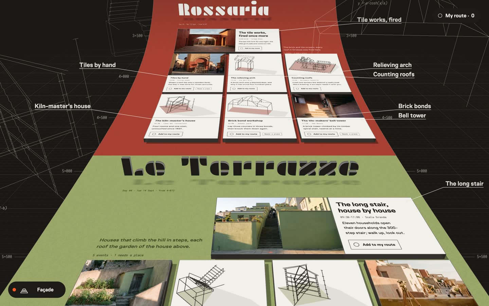

# All You Need Is Taste: skills

Agent skills from [All You Need Is Taste](https://github.com/allyouneedistaste), free under the MIT licence.

## runway-site

Build a complete website whose whole live page tips over into a long floor you travel in 3D: a dark
room drawn like a technical drawing, section titles standing up, cards raised as slabs, labels on leader
lines, and every button still clickable.



```
npx skills add allyouneedistaste/skills --skill runway-site
```

Then ask your agent for a site you can walk through, or run `/runway-site`. It interviews you, plans, makes
the pictures (only after you agree a total), builds plain files with no framework, checks them headlessly
and gets a fresh review.

**What it needs**

- Node 22 or newer, and Chrome. `scripts/doctor.mjs` says what is missing.
- To see the 3D mode: Chrome 157 or later, or Chrome 147 to 156 with `chrome://flags/#canvas-draw-element`.
  It uses HTML-in-Canvas and WebGPU, on HTTPS or localhost, a fine pointer and a window 1024 px or wider.
  Everywhere else the page stays flat and complete, and the button does not appear.
- A long page with chapters: a short one has no floor to travel.
- For generated pictures, your own image tool or your own `KIE_API_KEY`. You pay for those; nothing else costs money.

**Known limits:** no travel by touch, so no 3D on phones; hover does not show on the floor; far text is not readable.

Licence: [MIT](LICENSE). Third-party notes: [NOTICE.md](NOTICE.md).
